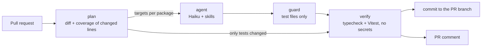

# Unit test agent

A Claude Code agent with five skills writes and updates the Vitest unit tests of this repository. A GitHub Actions workflow runs it on every pull request. The workflow finds the changed lines that no test executes, the agent decides which files need tests and writes them, a separate job without secrets verifies the result, and the workflow commits the tests to the pull request branch and posts a report comment. A manual sweep mode runs the same agent over the least tested files of the whole application and pushes a branch for review.



## Technical decisions

**Claude Code CLI in headless mode as the agent environment.** The workflow calls `claude -p --agent unit-test-agent` directly instead of `claude-code-action`. One command line then holds every control: model, tool list, permission rules, turn and dollar limits, and a JSON transcript of every tool call. The agent and skills are ordinary Claude Code files, so a developer can use the same agent locally.

**Haiku only.** Every run uses `claude-haiku-5-5`, set three ways: `--model`, the alias variables (`ANTHROPIC_DEFAULT_SONNET_MODEL` and the others point at Haiku) and the agent's `model: haiku`. After the run the workflow reads the billed models from the transcript and fails the job if any of them is not Haiku. The demo pull request cost $0.02 for both packages, the full coverage sweep $0.06.

**Deterministic planning before the model.** The plan job runs the existing tests with coverage, intersects the lcov line hits with the pull request diff and writes a manifest per package: each changed source file, its changed lines, the changed lines no test executes and the tests that import or mock it. Files outside unit-test coverage (types, barrels, the design system and the entries listed in `config.json`) are skipped by rule and shown as such in the comment. The model only judges what needs judgment, and each run has a cap on the number of targets.

**One agent session per package.** Backend and frontend run as a matrix, in parallel, each with a smaller context and its own test-writing skill.

**The workflow, not the agent, reports results.** Test counts, typecheck status and coverage come from the verify job, which runs the whole suite of the package in a clean checkout. The list of skills used comes from the transcript. The agent's structured report only supplies the decision and reason per file.

### Trust boundaries

| Risk | Control |
| --- | --- |
| A fork pull request reads the API key | The trigger is `pull_request`, never `pull_request_target`. Forks get no secrets, and the agent jobs are skipped for them. |
| A pull request edits the agent, its skills or its permissions, or adds a `CLAUDE.md` | The agent job restores `.claude/` and `.github/test-agent/` from the base branch, deletes `CLAUDE.md` files and sets `CLAUDE_CODE_DISABLE_CLAUDE_MDS=1`. |
| Prompt injection through code, comments or test output | The agent runs in `dontAsk` mode with Read, Glob, Grep, Edit, Write, Bash and Skill only. Edits are allowed in test files only, Bash runs the test runner and read-only commands inside the repository, file reads stay inside the repository, and only the five project skills load. |
| Code under test reads the key from the agent's environment | The runner script executes Vitest and `tsc` in a `node` container pinned by digest, with `--network none`, without the agent's environment, and with `.git`, `.github` and `.claude` mounted read-only. |
| The agent changes something other than tests | A separate guard step, run from the trusted copy, rejects files outside the test globs, deletions, symlinks, focused or skipped tests, `child_process`, `@ts-nocheck`, key-shaped strings and oversized patches. |
| Untested or failing tests get committed | The commit job runs only after verify passed for every package. It repeats the guard from the base branch and refuses to push if the branch moved. |
| The agent triggers itself forever | Pushes use `GITHUB_TOKEN`, and GitHub holds the pull request runs of such a push until a maintainer approves them. Agent commits carry a `Unit-Test-Agent:` trailer, so an approved agent run stops at the plan job. `concurrency` cancels outdated runs. |
| Agent text in the comment pings people or hides links | Agent strings are flattened and escaped, mentions and URLs are defused, and key-shaped strings are redacted. |
| Supply chain | Actions are pinned to commit SHAs. Claude Code is installed from a lockfile with integrity hashes and `--ignore-scripts`. Dependabot keeps both current. |

The workflow grants no permissions by default; each job requests its own. The commit job is the only one that writes contents, commit statuses and workflow dispatches. The report job is the only one that writes pull request comments.

### Reliability

- Every job has a timeout, and the agent process has a 25-minute limit.
- `--max-turns` and `--max-budget-usd` cap each run (`config.json`: 60 turns and $1 for pull requests, 200 turns and $3 for sweeps).
- A run that ends without a result or bills a non-Haiku model fails the job, and nothing is committed. The first sweep found this gap: the agent never started, yet the run stayed green ([#2](https://github.com/saldoran/cf-recruitment/pull/2) fixed it).
- The agent makes at most three fix attempts per test file and reports a target as skipped instead of looping.
- After pushing tests, the commit job sets a commit status and dispatches CI, so the bot commit gets check results without waiting for an approval.

## Running the workflow

Prerequisites:

- GitHub Actions enabled for the repository.
- A repository secret `ANTHROPIC_API_KEY`. Without it the agent job fails with a clear message and nothing is committed.
- Docker on the runner. GitHub-hosted `ubuntu-24.04` runners have it.

**Pull requests.** Open or update a pull request that touches `backend/src`, `backend/tests` or `frontend/src`. Draft pull requests and pull requests labelled `skip-test-agent` are skipped. The result is a commit with the new tests on the branch, a commit status, and a comment that every run updates.

**Sweep.** Open Actions → Unit test agent → Run workflow and choose the packages. The tests land on a branch `test-agent/sweep-<run id>`, and the job summary links to a compare view for opening a pull request.

**Locally.** The same agent works in an interactive session:

```bash
claude --agent unit-test-agent
```

The workflow tooling has its own tests:

```bash
cd .github/test-agent && npm test
```

## Where the agent and skills live

| File | Role |
| --- | --- |
| `.claude/agents/unit-test-agent.md` | The agent: inputs, workflow, rules, Haiku model |
| `.claude/skills/analyze-changes/` | Pull-request mode: decide create, update or skip for each changed file |
| `.claude/skills/find-coverage-gaps/` | Sweep mode: plan tests for uncovered lines and order the work by value |
| `.claude/skills/write-backend-tests/` | Backend conventions: Supertest, Prisma without a database, environment and lifecycle patterns |
| `.claude/skills/write-frontend-tests/` | Frontend conventions: Testing Library, design-system doubles, React Query hooks, `fetch`, timers |
| `.claude/skills/run-tests/` | Run tests, read failures, fix the tests and never the source, limit attempts |
| `.github/test-agent/agent-settings.json` | Permission rules for CI runs |
| `.github/test-agent/config.json` | Package globs, the Haiku model, limits |
| `.github/test-agent/bin/run-tests.sh` | The only command the agent may run, and the Docker sandbox |
| `.github/test-agent/scripts/` | The plan, guard, transcript, verify-summary and report commands, with their tests |

The prompt gives the agent the path of its package's manifest. The agent reads it, loads `analyze-changes` (or `find-coverage-gaps` in a sweep), then the test-writing skill for its package, then `run-tests`, and ends with a structured report validated against `report.schema.json`.

## Example run

### Pull request [#4](https://github.com/saldoran/cf-recruitment/pull/4): clear all completed tasks

The feature adds `DELETE /api/todos/completed` and a "Clear completed" button, and ships without tests. Before the agent ran, the backend typecheck failed in `router.test.ts`, the frontend typecheck failed in `TodosHeader.test.tsx`, and ten `TodosPage` tests failed because the page now used a new hook.

[The workflow run](https://github.com/saldoran/cf-recruitment/actions/runs/40771491316):

1. **Plan.** Six targets, two in the backend and four in the frontend. `types.ts` and `queryKeys.ts` were skipped by rule. Before the agent ran, tests covered 1 of 4 changed backend lines and 5 of 16 changed frontend lines.
2. **Agent.** One Haiku session per package made these decisions:

| File | Decision | What the tests check |
| --- | --- | --- |
| `backend/src/features/todos/repository.ts` | update `repository.test.ts` | `deleteCompleted` deletes only completed tasks and returns the count |
| `backend/src/features/todos/router.ts` | update `router.test.ts` | `DELETE /completed` answers `{ deleted }` and never calls `delete(id)`; the stub repository gained `deleteCompleted` |
| `frontend/src/features/todos/api/todos.ts` | update `todos.test.ts` | the request goes to `DELETE /todos/completed` and returns the count |
| `frontend/src/features/todos/hooks/useClearCompletedMutation.ts` | create `useClearCompletedMutation.test.tsx` | completed tasks leave the cached list; an all-open list stays as it was |
| `frontend/src/features/todos/components/TodosHeader.tsx` | update `TodosHeader.test.tsx` | the button's visibility, label, click and disabled state; the old test got the new props |
| `frontend/src/features/todos/TodosPage.tsx` | update `TodosPage.test.tsx` | the new hook is mocked; the busy guard, singular and plural notices, and the error path |

   Skills used: `analyze-changes`, `write-backend-tests` and `run-tests` for the backend; `analyze-changes`, `write-frontend-tests` and `run-tests` for the frontend.
3. **Guard and verify.** The guard accepted six test files. Backend: 79 tests passed, typecheck passed, changed lines covered 4/4. Frontend: 86 tests passed, typecheck passed, changed lines covered 16/16.
4. **Commit and report.** Commit [`7448b95`](https://github.com/saldoran/cf-recruitment/commit/7448b95018e18807254578d2516385a0bcc5eb52) landed on the branch with the status `unit-test-agent / verify`. The [comment](https://github.com/saldoran/cf-recruitment/pull/4#issuecomment-6481081307) lists every decision with its reason, the test results, the skills and the cost: $0.006 for the backend, $0.014 for the frontend.

### Pull request [#6](https://github.com/saldoran/cf-recruitment/pull/6): task counts

A smaller, backend-only change adds `GET /api/todos/stats`. The agent updated `repository.test.ts` and `router.test.ts`: changed lines covered went from 1/3 to 3/3, all 79 backend tests passed, and the run cost $0.006. The commit job dispatched CI for the bot commit, and CI passed. Approving the runs GitHub held for the bot commits of #4 and #6 ran CI on them once more, while the agent run stopped at the plan job because of the trailer, leaving the comments as they were.

#4 and #6 stay open as examples. They change the same files, so merging one would put the other in conflict.

### Coverage sweep

The [sweep run](https://github.com/saldoran/cf-recruitment/actions/runs/40770405198) covered the code that had no tests, and [#3](https://github.com/saldoran/cf-recruitment/pull/3) merged the result:

| Package | Tests | Line coverage | Turns | Cost |
| --- | --- | --- | --- | --- |
| backend | 48 → 77 | 33.0% → 100% | 31 | $0.015 |
| frontend | 18 → 76 | 47.7% → 100% | 63 | $0.047 |

The workflow run on #3 also shows the loop guard at work: the head commit came from the agent, so the plan job stopped there.

## Assumptions

- Collaborators with write access are trusted as far as that access already allows. The controls target prompt injection, accidents and forks, not a malicious collaborator.
- Unit tests only. Prisma is mocked, as in the existing tests, and nothing needs a database.
- Vitest's v8 coverage decides which changed lines lack tests.
- A generated test is acceptable when the package typechecks and its whole suite passes in a clean job. People still review the bot commit in the pull request.

## Limitations

- GitHub runs the workflow file from the pull request branch, so a collaborator can edit the workflow itself.
- The pull request runs of a bot commit wait for a maintainer's approval. The dispatched CI run gives the commit results meanwhile, but GitHub does not list it among the pull request's checks.
- Pull requests from forks get CI but no agent run.
- The guard checks structure, not meaning: a passing test can still be shallow.
- A large pull request gets at most eight targets per package; the comment lists the rest as not analysed.
- A sweep has no pull request to comment on, so its report lives in the job summary.
- The sandbox needs Linux runners with Docker.

## Production version

- Push bot commits with a GitHub App token, which gives the bot its own identity and lets branch protection and required checks treat its commits like any other.
- Keep the API key in a GitHub environment, and add spend alerts and per-repository budgets.
- Grade generated tests with mutation testing and reject tests that kill no mutants.
- Cache the sandbox dependencies or ship a prebuilt sandbox image to cut run time.
- Package the agent and skills as a Claude Code plugin, and read the package layout from workspace configuration, so other repositories can reuse them.
- Track the cost per pull request and how often people revert bot commits.
